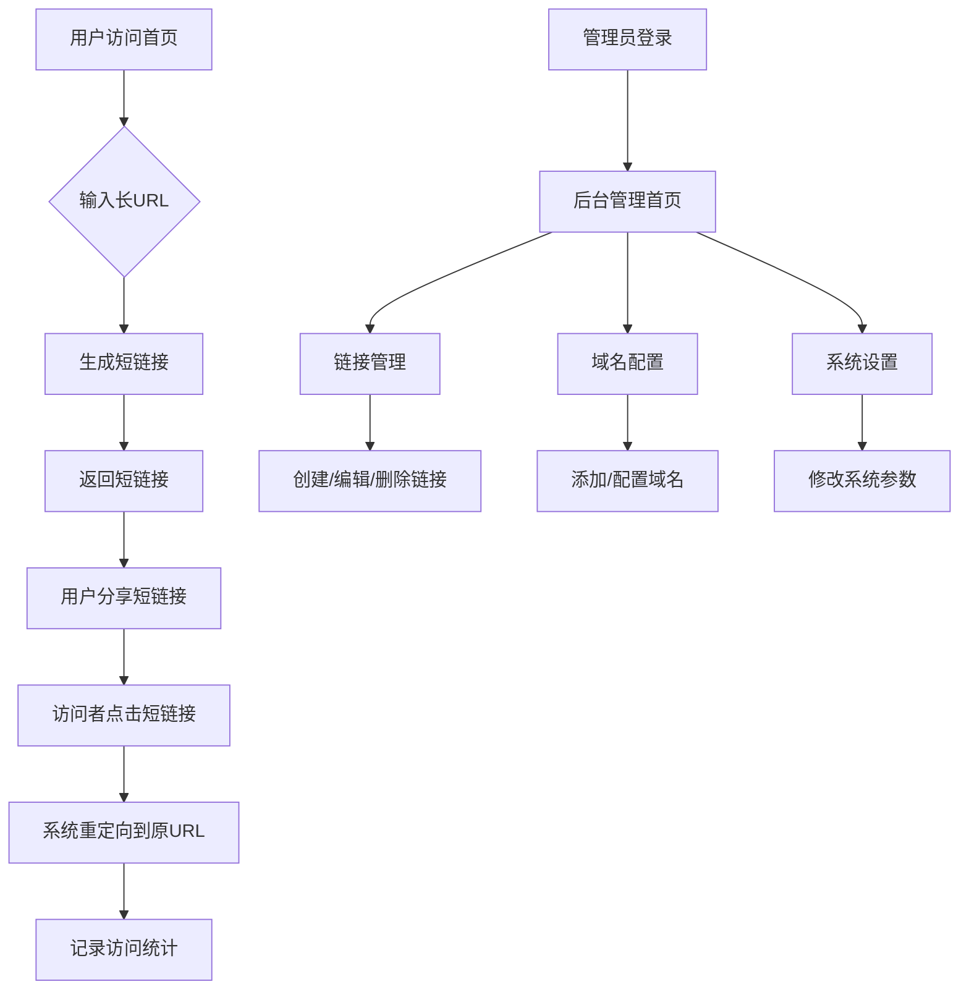

## 1. 产品概述
短链接服务应用，提供URL缩短功能，支持自定义域名配置。包含现代化的Web后台管理系统，用于链接管理和系统配置，界面简洁美观，全端适配。

目标用户：需要管理和分享短链接的个人用户和企业用户，解决长URL不便于分享和记忆的问题。

## 2. 核心功能

### 2.1 用户角色
| 角色 | 注册方式 | 核心权限 |
|------|----------|----------|
| 管理员 | 系统初始化创建 | 系统配置、域名管理、链接管理、用户管理 |
| 普通用户 | 邮箱注册 | 创建短链接、查看个人链接统计 |

### 2.2 功能模块
短链接应用包含以下主要页面：
1. **首页**：短链接生成、链接访问重定向
2. **后台管理登录页**：管理员身份验证
3. **后台管理首页**：数据统计概览
4. **链接管理页**：短链接列表、创建、编辑、删除
5. **域名配置页**：自定义域名设置
6. **系统设置页**：系统参数配置

### 2.3 页面详情
| 页面名称 | 模块名称 | 功能描述 |
|-----------|----------|----------|
| 首页 | 链接生成模块 | 输入长URL生成短链接，支持自定义短码，显示生成结果 |
| 首页 | 重定向模块 | 接收短链接请求，重定向到原始URL，记录访问统计 |
| 后台管理登录页 | 登录表单 | 输入用户名密码进行身份验证，支持记住登录状态 |
| 后台管理首页 | 数据统计面板 | 显示总链接数、今日访问量、系统运行状态等关键指标 |
| 后台管理首页 | 快速操作区 | 快速创建短链接、查看最近活动、系统通知 |
| 链接管理页 | 链接列表 | 分页显示所有短链接，支持搜索、筛选、排序 |
| 链接管理页 | 链接操作 | 创建新链接、编辑现有链接、删除链接、批量操作 |
| 链接管理页 | 访问统计 | 显示每个链接的访问次数、访问来源、时间分布 |
| 域名配置页 | 域名列表 | 显示已配置的域名，支持添加、删除、启用/禁用 |
| 域名配置页 | 域名设置 | 配置域名解析、SSL证书、访问限制等参数 |
| 系统设置页 | 基础设置 | 配置网站标题、Logo、访问限制、缓存策略 |
| 系统设置页 | 高级设置 | 配置数据库连接、邮件服务、备份策略 |

## 3. 核心流程

### 用户访问流程
1. 用户在首页输入长URL，可选择自定义短码
2. 系统生成短链接并返回给用户
3. 用户分享短链接，访问者点击短链接
4. 系统接收请求，查询对应长URL，执行重定向
5. 记录访问日志和统计数据

### 管理员操作流程
1. 管理员通过登录页面进入后台管理系统
2. 在首页查看系统运行状态和关键指标
3. 在链接管理页面管理所有短链接
4. 在域名配置页面设置自定义域名
5. 在系统设置页面配置系统参数

## 4. 用户界面设计

### 4.1 设计风格
- **主色调**：深蓝色 (#2563eb) 作为主色，白色背景，灰色辅助色
- **按钮样式**：圆角矩形设计，主要按钮使用主色调，次要按钮使用边框样式
- **字体**：系统默认字体，标题使用加粗大字号，正文使用常规字号
- **布局风格**：卡片式布局，左侧导航菜单，右侧内容区域
- **图标风格**：使用简洁的线性图标，保持视觉一致性

### 4.2 页面设计概览
| 页面名称 | 模块名称 | UI元素 |
|-----------|----------|-------------|
| 首页 | 链接生成模块 | 居中布局，大输入框，生成按钮醒目，结果以卡片形式展示 |
| 后台管理首页 | 数据统计面板 | 网格布局显示统计卡片，使用图表展示趋势数据 |
| 链接管理页 | 链接列表 | 表格形式展示，每行显示链接信息，操作按钮在右侧 |
| 域名配置页 | 域名列表 | 卡片列表形式，每个域名一个卡片，显示状态和操作 |
| 系统设置页 | 设置表单 | 分组表单布局，使用开关、输入框、下拉选择等控件 |

### 4.3 响应式设计
- **桌面优先**：默认设计为桌面端，然后适配移动端
- **断点设置**：768px（平板）、480px（手机）
- **移动端适配**：导航菜单折叠为汉堡菜单，表格转为卡片列表
- **触摸优化**：按钮和链接增大点击区域，支持触摸滑动操作

### 4.4 管理后台UI规范
- **导航栏**：固定在顶部，包含Logo、用户信息和退出按钮
- **侧边栏**：可折叠的导航菜单，图标+文字形式
- **内容区域**：白色背景，适当的内边距，卡片阴影效果
- **表单设计**：统一的输入框样式，清晰的标签和错误提示
- **按钮规范**：主要操作用主色调，危险操作用红色，禁用状态用灰色