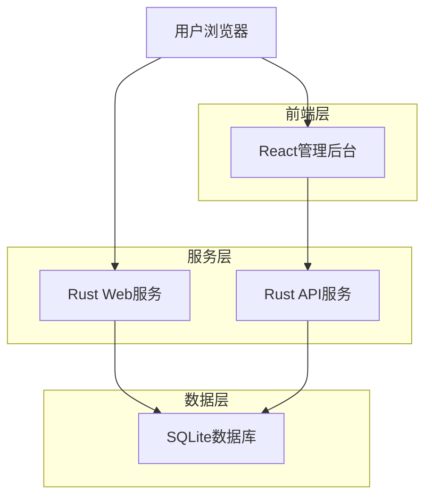
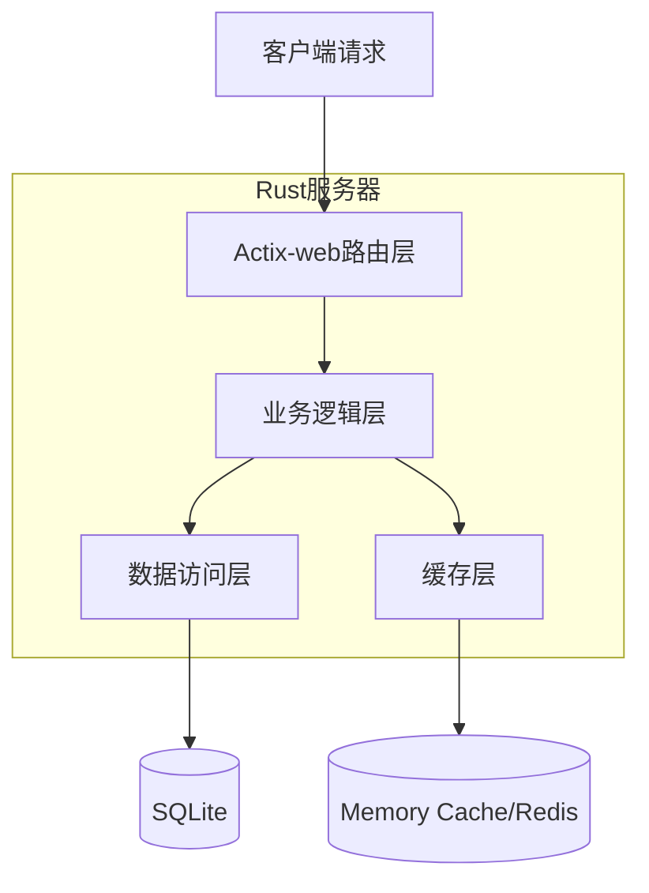
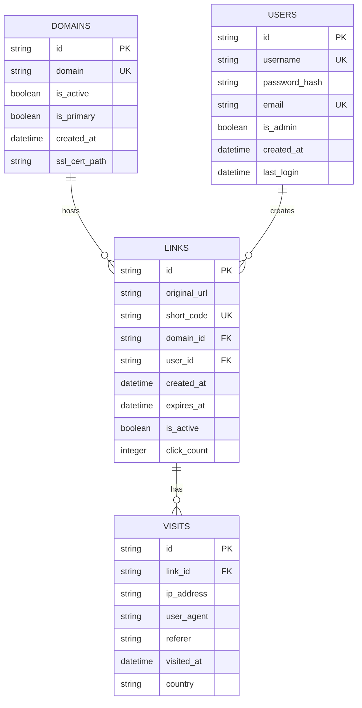

## 1. 架构设计



## 2. 技术描述

- **后端**: Rust + Actix-web + SQLite
- **前端**: React@18 + TypeScript + TailwindCSS@3 + Vite
- **初始化工具**: vite-init
- **数据库**: SQLite (项目内单文件生成，如 `data/shortlink.db`，便于整体迁移)
- **缓存**: 内存缓存 (如 `moka`) 或 Redis（可选，用于提升性能）

## 3. 路由定义

| 路由 | 用途 |
|-------|---------|
| / | 短链接生成首页 |
| /:short_code | 短链接重定向 |
| /admin | 管理后台登录页 |
| /admin/dashboard | 管理后台首页 |
| /admin/links | 链接管理页面 |
| /admin/domains | 域名配置页面 |
| /admin/settings | 系统设置页面 |
| /api/admin/login | 管理员登录API |
| /api/admin/links | 链接管理API |
| /api/admin/domains | 域名配置API |
| /api/admin/stats | 统计数据API |

## 4. API定义

### 4.1 短链接生成API
```
POST /api/shorten
```

请求:
| 参数名 | 参数类型 | 是否必需 | 描述 |
|-----------|-------------|-------------|-------------|
| url | string | true | 原始长URL |
| custom_code | string | false | 自定义短码 |
| expires_at | datetime | false | 过期时间 |

响应:
| 参数名 | 参数类型 | 描述 |
|-----------|-------------|-------------|
| short_url | string | 生成的短链接 |
| short_code | string | 短码 |
| qr_code | string | QR码图片URL |

示例:
```json
{
  "url": "https://example.com/very/long/url/path",
  "custom_code": "abc123"
}
```

### 4.2 管理员登录API
```
POST /api/admin/login
```

请求:
| 参数名 | 参数类型 | 是否必需 | 描述 |
|-----------|-------------|-------------|-------------|
| username | string | true | 用户名 |
| password | string | true | 密码 |

响应:
| 参数名 | 参数类型 | 描述 |
|-----------|-------------|-------------|
| token | string | JWT令牌 |
| expires_in | number | 过期时间（秒） |

### 4.3 链接列表API
```
GET /api/admin/links
```

查询参数:
| 参数名 | 参数类型 | 描述 |
|-----------|-------------|
| page | number | 页码 |
| limit | number | 每页数量 |
| search | string | 搜索关键词 |
| status | string | 链接状态 |

响应:
| 参数名 | 参数类型 | 描述 |
|-----------|-------------|
| data | array | 链接数据数组 |
| total | number | 总数量 |
| page | number | 当前页码 |

## 5. 服务器架构图



## 6. 数据模型

### 6.1 数据模型定义


### 6.2 数据定义语言 (SQLite 方言)

链接表 (links)
```sql
CREATE TABLE links (
    id TEXT PRIMARY KEY, -- 应用程序生成 UUID
    original_url TEXT NOT NULL,
    short_code VARCHAR(50) UNIQUE NOT NULL,
    domain_id TEXT REFERENCES domains(id),
    user_id TEXT REFERENCES users(id),
    created_at DATETIME DEFAULT CURRENT_TIMESTAMP,
    expires_at DATETIME,
    is_active INTEGER DEFAULT 1, -- 1: true, 0: false
    click_count INTEGER DEFAULT 0
);

CREATE INDEX idx_links_short_code ON links(short_code);
CREATE INDEX idx_links_domain ON links(domain_id);
CREATE INDEX idx_links_created_at ON links(created_at DESC);
```

访问记录表 (visits)
```sql
CREATE TABLE visits (
    id TEXT PRIMARY KEY,
    link_id TEXT REFERENCES links(id) ON DELETE CASCADE,
    ip_address TEXT,
    user_agent TEXT,
    referer TEXT,
    visited_at DATETIME DEFAULT CURRENT_TIMESTAMP,
    country VARCHAR(2)
);

CREATE INDEX idx_visits_link_id ON visits(link_id);
CREATE INDEX idx_visits_visited_at ON visits(visited_at DESC);
```

域名表 (domains)
```sql
CREATE TABLE domains (
    id TEXT PRIMARY KEY,
    domain VARCHAR(255) UNIQUE NOT NULL,
    is_active INTEGER DEFAULT 1,
    is_primary INTEGER DEFAULT 0,
    created_at DATETIME DEFAULT CURRENT_TIMESTAMP,
    ssl_cert_path TEXT
);
```

用户表 (users)
```sql
CREATE TABLE users (
    id TEXT PRIMARY KEY,
    username VARCHAR(50) UNIQUE NOT NULL,
    password_hash VARCHAR(255) NOT NULL,
    email VARCHAR(255) UNIQUE NOT NULL,
    is_admin INTEGER DEFAULT 0,
    created_at DATETIME DEFAULT CURRENT_TIMESTAMP,
    last_login DATETIME
);

CREATE INDEX idx_users_username ON users(username);
CREATE INDEX idx_users_email ON users(email);
```

### 6.3 初始数据
```sql
-- 插入默认管理员用户（密码：admin123），注意 id 需程序生成，此处为示例 UUID
INSERT INTO users (id, username, password_hash, email, is_admin) 
VALUES ('b4c59914-41e7-4b95-a4b0-8eb7bc8514db', 'admin', '$2b$12$LQv3c1yqBWVHxkd0LHAkCOYz6TtxMQJqhN8/LewdBPj/RK.PJFu.', 'admin@example.com', 1);

-- 插入默认域名
INSERT INTO domains (id, domain, is_primary) 
VALUES ('c4c59914-41e7-4b95-a4b0-8eb7bc8514dc', 'localhost:8080', 1);
```